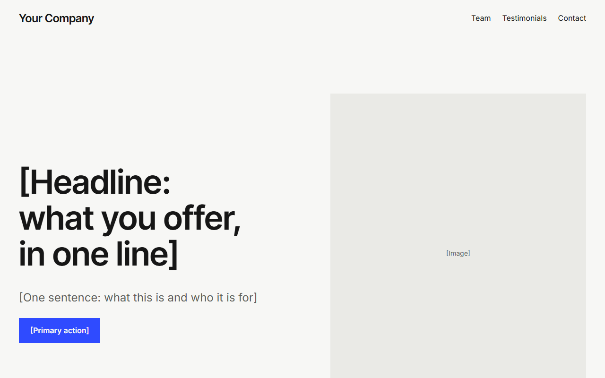

# Dynaweb Studio

**A universal visual website generator with an animation designer built in.** Any kind of site, for any purpose: a business, portfolio, event, community, product or publication. Describe it in your own words, get a structured draft with a distinct visual identity, then control every section, style and animation in a visual editor and export a standalone website.

Dynaweb is early (pre-1.0) and open to contributors. Everything marked *planned* below is not built yet.



*A generated starting point. Text in [brackets] is a placeholder: Dynaweb never invents business facts.*

## The three animation systems

Every animation is stored as structured data on a section and edited with real controls. The same dependency-free runtime drives the editor preview and the exported site.

### 1. Parallax: 3D depth

Layers move at different speeds as you scroll, so a section gains depth.

- Background speed, depth intensity, layer scale and perspective
- Vertical, horizontal or two-axis movement
- Optional mouse-follow with adjustable strength
- Up to six extra layers (background, midground, foreground), each with its own image, speed and opacity
- Foreground content moves against the background for a real depth effect

### 2. Scroll reveal: scroll-triggered animation

Elements animate in as they enter the viewport.

- 12 effects: fade in, fade out, slide up/down/left/right, zoom in/out, blur, rotate, scale, clip reveal
- Apply to the whole section, its children, or only headings, images, buttons or cards
- Duration, delay, stagger, easing, distance, initial opacity, scale and rotation, trigger threshold
- Play once, or replay every time it scrolls into view
- A timeline view shows how staggered elements overlap
- Click any heading, image, button or card on the canvas to give that one element its own reveal

### 3. Horizontal scroll: immersive galleries

A vertical section becomes a pinned, sideways-scrolling story.

- Panel width, gap, scroll speed, left-to-right or right-to-left
- Snap to panels, progress bar, panel indicators
- Several horizontal sections can share one page
- On phones it becomes a vertical stack or a native swipe carousel

All three respect `prefers-reduced-motion`, keep content visible without JavaScript, and animate only `transform`, `opacity`, `filter` and `clip-path`.

## What works today

- **Creation wizard:** website name, business type, industry, audience, language, objective, a free-text brief, a choice of four original design presets, and animation intensity. Words in the brief such as *parallax*, *cinematic* or *horizontal gallery* switch on the matching animations.
- **Visual editor:** section list with drag-and-drop reordering, duplicate and delete; a section library; a live canvas where you click a section to select it; desktop, tablet and mobile preview; zoom; undo and redo.
- **Inspector:** content (headings, text, buttons, images, items), style (background, alignment, spacing, width, columns, per-device visibility), animation designers, and theme (presets, fonts, colours, radius, type scale, motion level).
- **Area starting points (optional):** pick hotel, tourism, restaurant, AI or tech business, software, service company, agency, shop, real estate, education, events, health, non-profit, portfolio or personal site to pre-fill the objective, atmosphere, sections, search-engine type and placeholder headings. Everything stays editable; "Other" starts from scratch.
- **Universal brief and art direction:** describe the project in your own words (purpose, optional activity, audience, objective, colours, typography, imagery, layout, motion, functionality). Dynaweb suggests a structure from your objective and words, never from an industry, and you tick exactly the sections you want. Three design proposals are ranked by atmosphere and your colour preferences.
- **Building blocks:** 17 section types, including Text, Image or video (files, YouTube, Vimeo) and a free-form Custom section, each with layout variants.
- **Layout variants:** every section type has several layouts (split, full-bleed or editorial hero, numbered or featured-first lists, masonry or filmstrip galleries, spotlight quotes...). Each preset composes pages differently, and you can switch any section's layout in the Style tab.
- **Working forms:** contact and booking forms with real-time validation that post to any https form endpoint, and say honestly when no endpoint is connected. Booking requests are never shown as confirmed.
- **SEO:** Open Graph, canonical URL, JSON-LD from real facts only, sitemap.xml and robots.txt.
- **Image upload:** an Assets panel to upload JPEG, PNG, WebP or GIF images (kept sharp up to 2560 px, stored in your browser, never on a server) and pick them in any image field. Exports embed them; saved project files carry them.
- **Export:** one standalone HTML file with its CSS and the animation runtime inlined. Projects save automatically in the browser and can be saved and opened as `.dynaweb.json` files.

*Planned:* more section types, multi-page sites, an assets panel, ZIP export and publishing. See the [roadmap](ROADMAP.md).

## Quick start

Requires Node.js 20 or newer.

```bash
git clone https://github.com/JOKAIR99/Dynaweb.git
cd Dynaweb
npm ci
npm run dev
```

Open http://localhost:5173, click **New website**, and try this brief:

> Premium private boat tours in Thailand. Cinematic hero, parallax backgrounds, scroll-revealed content and an immersive horizontal gallery.

Other commands: `npm test`, `npm run lint`, `npm run typecheck`, `npm run build`, `npm run check` (everything CI runs), `npm run sample` (renders a sample site to `dist/sample.html`).

## AI assistant

Open a project, go to the **AI** tab and describe a change in your own words ("make the hero more dramatic, add a section about our process"). **No API key is needed:**

1. Click **Copy prompt for Claude**. Dynaweb writes a complete prompt with your project and request.
2. Paste it into your own Claude chat (claude.ai or the Claude app) and copy Claude's whole answer.
3. Paste the answer into Dynaweb and click **Check answer**.

Every proposed change is validated against the site model before you see it; rejected ones are shown with the reason. Untick anything you don't want and click **Apply**: one Undo reverts the whole change. Facts you still need to provide are listed, never invented.

*Optional:* a developer can instead set `ANTHROPIC_API_KEY` where the dev server runs (see `.env.example`) and use "Ask the server assistant". The key stays on the server and each request is billed to that account. Dynaweb works fully without it.

## Architecture

```
Commands (editor UI today, AI assistant later)
        |
        v
applyCommand()  -->  validated, immutable Project (Zod schema)  -->  versioned store
                                  |
                                  v
                   renderer (model -> HTML/CSS)  -->  editor canvas (sandboxed iframe)
                                  |                    and exported site
                                  v
                   animation runtime (parallax, reveal, horizontal)
```

- The structured site model is the single source of truth. HTML is always derived from it.
- Every edit is a typed command that is validated before it is applied, which is how the AI assistant will make changes safely.
- The editor and the exported site are separate: exports contain no editor code.

Full details: [`docs/architecture.md`](docs/architecture.md).

| Layer | Technology |
|---|---|
| Editor | React 18, TypeScript, Vite |
| Site model | Zod schemas |
| Animation runtime | Plain JavaScript, IntersectionObserver, requestAnimationFrame, CSS transforms (no libraries) |
| Tests | Vitest, jsdom |
| CI | GitHub Actions: lint, typecheck, tests, build, dependency audit and review |

## Contributing

Contributions are welcome from anyone. You do not need write access: fork the repository, make your change on a branch, and open a pull request. CI checks it and the maintainer reviews it.

- Start with [`CONTRIBUTING.md`](CONTRIBUTING.md)
- Good starting points: issues labelled [`good first issue`](https://github.com/JOKAIR99/Dynaweb/labels/good%20first%20issue) and [`help wanted`](https://github.com/JOKAIR99/Dynaweb/labels/help%20wanted)
- Areas: frontend, backend, AI integration, UI/UX, animation engineering (parallax, scroll reveal, horizontal scroll), templates, documentation, testing, performance and accessibility

Please follow the [Code of Conduct](CODE_OF_CONDUCT.md). Report security issues privately as described in [`SECURITY.md`](SECURITY.md).

## Community

- [Discussions](https://github.com/JOKAIR99/Dynaweb/discussions): questions, ideas and show-and-tell
- [Issues](https://github.com/JOKAIR99/Dynaweb/issues): bugs and planned work
- [Changelog](CHANGELOG.md)

## Licence and credits

[MIT](LICENSE) © 2026 Jokair.

Dynaweb's design rules are adapted from [Hallmark](https://github.com/nutlope/hallmark) by Nutlope and Together AI (MIT). See [`NOTICE.md`](NOTICE.md).
